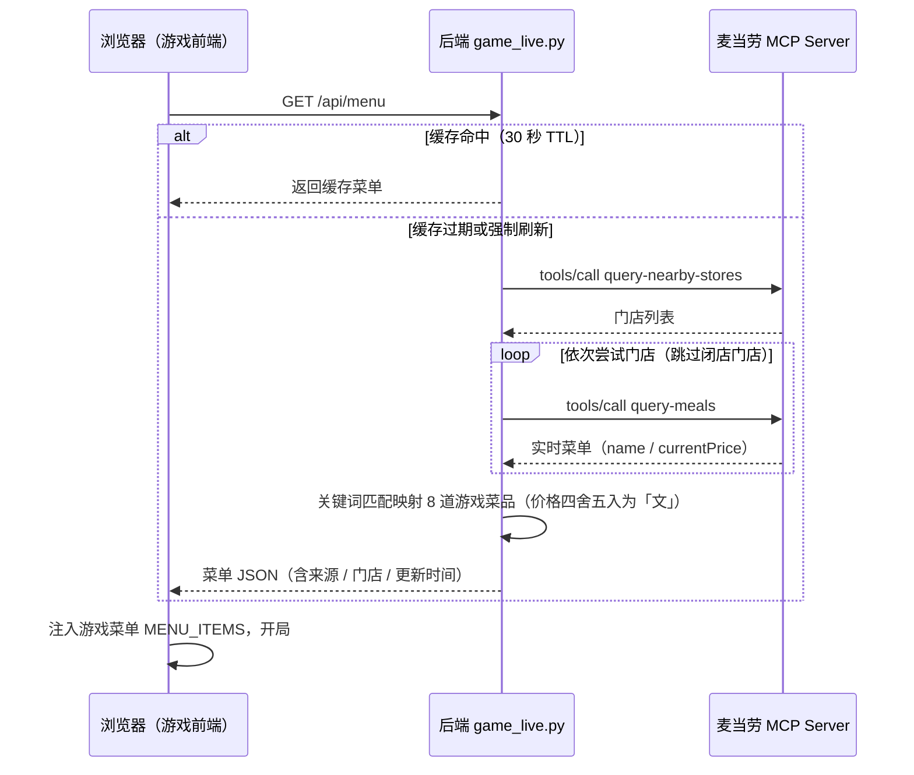

# MCP 集成说明

本文说明《推门 · 麦记穿越局》实际使用的麦当劳 MCP Server、Tool、调用流程与业务价值。

## 1. 使用的 MCP Server

| 项 | 值 |
|---|---|
| 名称 | 麦当劳中国 MCP Server（mcd-mcp） |
| 地址 | `https://mcp.mcd.cn` |
| 传输协议 | Streamable HTTP（JSON-RPC 2.0，`tools/call`） |
| 鉴权 | `Authorization: Bearer <MCD_MCP_TOKEN>` |
| 配置示例 | [mcp-config.example.json](./mcp-config.example.json)（仅环境变量占位符） |
| 接入代码 | `game_live.py` → `mcp_call()` |

## 2. 使用的 MCP Tools

### 2.1 `query-nearby-stores` —— 搜索真实门店

| 项 | 内容 |
|---|---|
| 用途 | 按「城市 + 关键词」搜索附近麦当劳门店，获取 `storeCode` |
| 入参 | `searchType=2`（按位置搜索）、`city`、`keyword`、`beType=1`（到店） |
| 出参 | `data[]`：门店列表（`storeCode` / `storeName` 等） |

### 2.2 `query-meals` —— 拉取门店实时菜单

| 项 | 内容 |
|---|---|
| 用途 | 拉取指定门店实时在售菜单（含名称与价格），映射为游戏菜单 |
| 入参 | `storeCode`、`orderType=1`（到店）、`beType=1` |
| 出参 | `data.meals`：以商品编码为 key 的菜品字典（`name` / `currentPrice` / `originalPrice` 等） |

响应节选（实测）：

```json
"data": {
  "meals": {
    "521741": { "name": "脆薯饼", "currentPrice": "8.5", "originalPrice": "8.5" },
    "9900005456": { "name": "麦辣鸡腿汉堡三件套", "currentPrice": "33.5", "originalPrice": "46" }
  }
}
```

> 实测示例（2026-10-18 深夜）：`北京市 / 三里屯` 搜索到 5 家门店，第一家门店闭店后自动切换至营业中的「麦当劳北京团结湖餐厅」，拉取到 112 个在售菜品，8 道游戏菜品全部匹配成功。

## 3. 调用流程



**降级策略**（保证任意时段可玩）：

1. 未配置 Token → 使用内置快照数据；
2. 网络波动 → 自动重试一次；
3. 门店闭店（业务错误码如 `600057`「门店可能已关闭或不在营业时间」）→ 自动切换下一家门店；
4. 全部门店不可用 → 回退内置快照，并在封面状态行注明「快照降级」。

## 4. 关键实现（game_live.py）

| 函数 | 职责 |
|---|---|
| `mcp_call()` | MCP JSON-RPC 调用封装：Bearer 鉴权、一次网络重试、业务错误识别 |
| `fetch_stores()` | 调用 `query-nearby-stores`：搜索门店列表 |
| `fetch_catalog()` | 调用 `query-meals`：拉取门店菜单并整理为「菜名 → 信息」字典 |
| `best_match()` | 菜名匹配：精确 / 前缀 / 包含三级打分，并对周边、套餐类关键词加惩罚，避免误匹配 |
| `build_items()` | 将匹配到的真实菜品映射为 8 道游戏菜品（价格四舍五入为整数「文」） |
| `get_live_menu()` | 编排：缓存（30s TTL）→ 门店尝试循环 → 降级回退 |

## 5. 业务价值

1. **真实数据驱动内容**：游戏菜单 = 真实门店此刻在售的真实菜品与价格。「考价关」考的是一份活的菜单——不同门店的价差（实测：巨无霸中关村店 25.5 元 / 团结湖店 26 元）都会体现在游戏里；
2. **场景示范：MCP × 游戏化互动**：把 MCP 从工具型助手拓展到互动娱乐场景，验证 MCP 在「内容生成 / 任务执行」之外的情绪价值与传播价值；
3. **到店体验预演**：玩家在 90 秒内对真实菜单建立价格记忆点，天然贴合「点餐决策」这一真实场景，为到店消费提供轻量前戏；
4. **生产级鲁棒性示范**：TTL 缓存 + 网络重试 + 闭店自动换店 + 快照降级，任意时段、任意网络环境均可运行。

## 6. 合规说明

- 仓库不包含任何真实 Token / 密钥 / 账号凭证；示例配置仅使用环境变量占位符；
- 餐品信息、价格及供应状态以麦当劳官方渠道的实时结果为准；本项目为参赛作品，非麦当劳官方产品。
