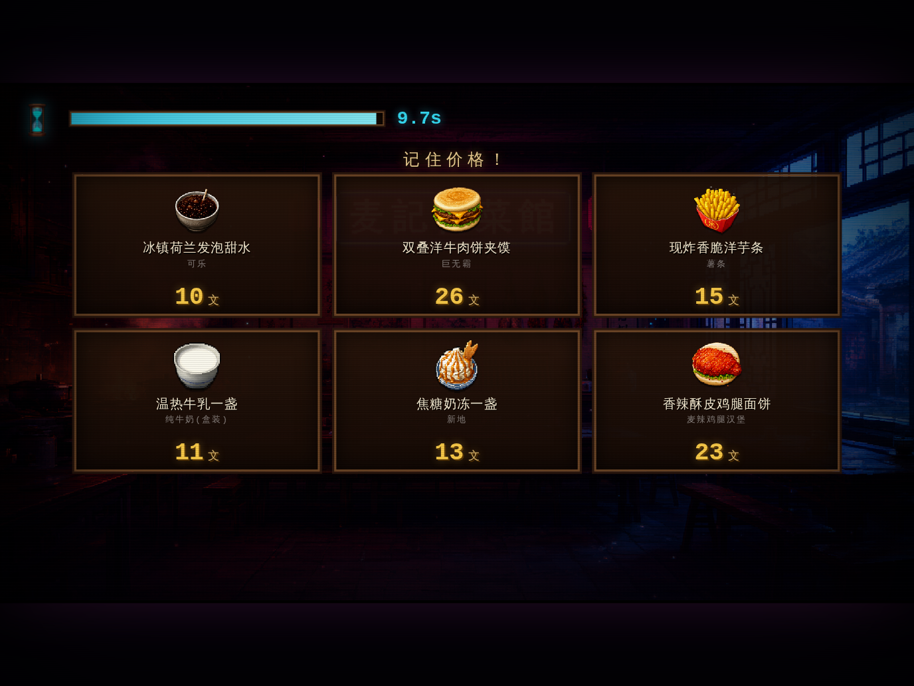
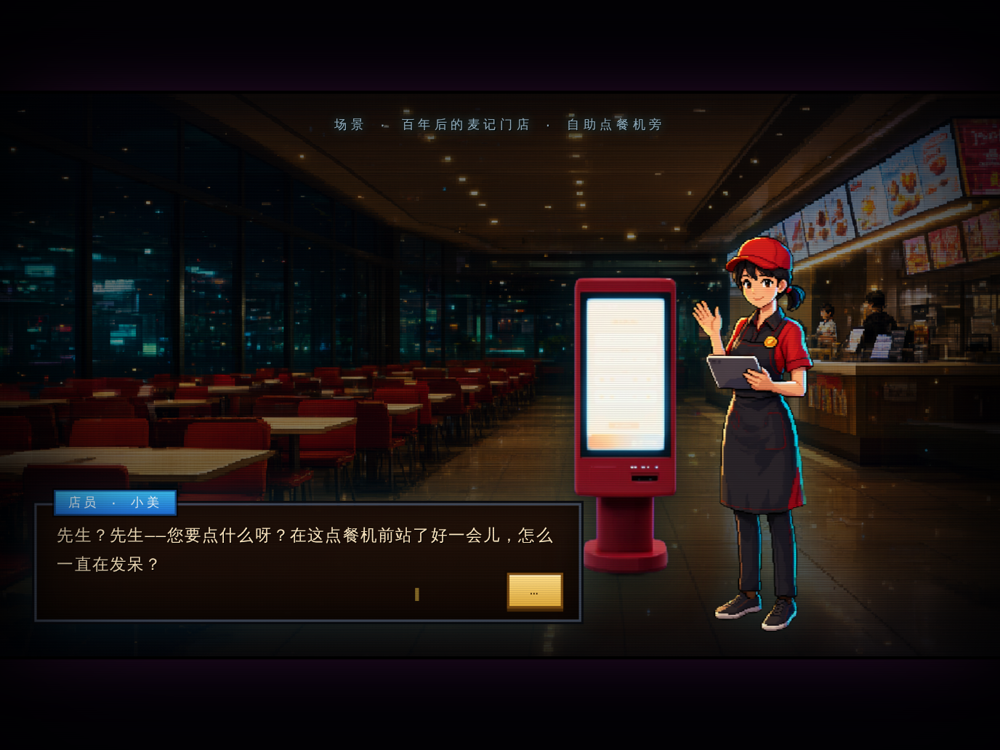

# 推门 · 麦记穿越局

> 一款接入麦当劳 MCP 实时数据的像素风「记价凑单」网页小游戏：推门穿越回百年前的麦记饭庄，跟掌柜过一场「考价关」——记住菜单、凑对水单，推开回家的门。

<p align="center">
  
</p>

## 项目简介

《推门 · 麦记穿越局》是一款单局约 90 秒的轻量网页小游戏，核心循环：

1. 点击「推门进店」，穿越到清末民初的「麦记」饭庄，小二交代规矩；
2. **记价**：菜单摆上桌，只有 10 秒记住每道菜的价格（单位：文）；
3. **凑单**：价码消散后，掌柜给出目标数目，30 秒内按记忆点选菜品凑单；
4. **判定**：总价不超过目标一成 → 推开「回家的门」（按误差评级「神算子 / 精明客 / 糊涂客」）；超出 → 留下洗碗，还可通过连点 QTE 复活重考一局。

与众不同的是：**游戏菜单不是写死的，而是后端通过麦当劳官方 MCP Server 实时拉取的真实门店数据**——你凑的每一单，都是一家真实麦当劳门店此刻在售的真实菜品与价格。

## 与麦当劳 MCP 的集成

| 环节 | 使用的 MCP Tool |
|---|---|
| 搜索真实门店（按城市 + 关键词） | `query-nearby-stores` |
| 拉取门店实时在售菜单（名称 / 价格） | `query-meals` |

- 启动游戏时，后端自动完成「搜索门店 → 挑选营业中的门店 → 拉取菜单 → 映射为 8 道游戏菜品」的流程（30 秒缓存，点击封面状态行可手动刷新）；
- 鲁棒性：网络波动自动重试；门店闭店自动切换下一家门店；全部门店不可用时回退内置快照数据，游戏不中断；
- 封面状态行实时显示数据来源：`📡 麦当劳 MCP · 门店名 · 更新时间 更新（实时 / 快照降级）· 点此刷新`。

详细调用流程、参数说明与业务价值见 [MCP_INTEGRATION.md](./MCP_INTEGRATION.md)。

## 快速开始

### 方式一：实时版（推荐，单文件前后端一体）

```bash
pip install flask
export MCD_MCP_TOKEN="申请到的麦当劳 MCP Token"   # 申请入口：https://open.mcd.cn/mcp
python3 game_live.py
```

浏览器打开 <http://127.0.0.1:8081>，封面状态行出现「📡 …更新（实时）」即代表实时数据接入成功。

支持的环境变量（均可选）：

| 环境变量 | 默认值 | 说明 |
|---|---|---|
| `MCD_MCP_TOKEN` | （无） | 麦当劳 MCP Token；不配置则直接使用内置快照数据 |
| `MCD_CITY` | 北京市 | 门店搜索城市 |
| `MCD_KEYWORD` | 中关村 | 门店搜索关键词（可换成任意城市商圈，如「三里屯」） |
| `MCD_STORE` | 1950640 | 门店搜索失败时的兜底门店编码 |
| `MCD_TTL` | 30 | 菜单缓存秒数 |
| `PORT` | 8081 | 服务端口 |

> 深夜门店闭店时段可能搜不到营业门店，游戏会自动使用内置快照并在状态行注明原因，不影响游玩。

### 方式二：纯前端离线版（无需 Token）

```bash
python3 serve.py
```

打开 <http://127.0.0.1:8080/game_demo.html>，使用内置快照数据离线游玩。

## 使用示例

| 记价（10 秒） | 凑单（30 秒） |
|---|---|
|  |  |

| 判定成功（推开回家的门） | 穿越回现代的麦记门店 |
|---|---|
|  |  |

一次典型对局：打开页面 → 点「推门进店」→ 记住 6 道菜价格 → 按目标凑单 → 提交水单 → 掌柜验讫 → 推开回家的门。

## 目录结构

```
.
├── game_live.py             # 单文件：Flask 后端（MCP 实时数据）+ 内嵌前端游戏
├── game_demo.html           # 纯前端离线版（内置快照数据，无需后端）
├── serve.py                 # 静态文件服务（本地预览用，禁用缓存）
├── game_assets/             # 美术素材：背景 / 角色 / 道具 / 菜品图标（AI 生成，含提示词清单）
├── images/                  # README 截图
├── mcp-config.example.json  # 脱敏 MCP 配置示例（仅环境变量占位符）
├── MCP_INTEGRATION.md       # MCP 集成说明：Server / Tool / 调用流程 / 业务价值
└── CONTEST_DECLARATION.md   # 参赛声明（官方模板）
```

## 目标用户

- 喜欢像素风、复古叙事和文字彩蛋的年轻玩家；
- 想在点餐前「顺便练一练心算」的消费者；
- 对麦当劳菜单与价格感兴趣的麦门粉丝；
- 想在等餐、通勤、工作学习间隙来一局 90 秒轻量小游戏的用户。

## 原创与合规说明

- 所有美术素材均由 AI 生成并经统一像素化后期处理，提示词与清单见 `game_assets/提示词清单.md`；
- 本项目为麦当劳程序员创意开发大赛参赛作品，由参赛者独立开发，**非麦当劳官方产品**；项目输出仅供参考，餐品信息、价格及供应状态以麦当劳官方渠道的实时结果为准；
- 仓库不包含任何真实 Token、密钥或账号凭证，`mcp-config.example.json` 仅使用环境变量占位符。
